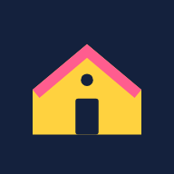
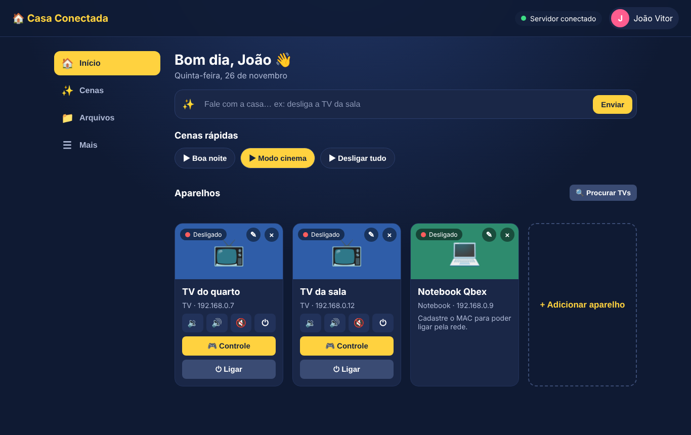
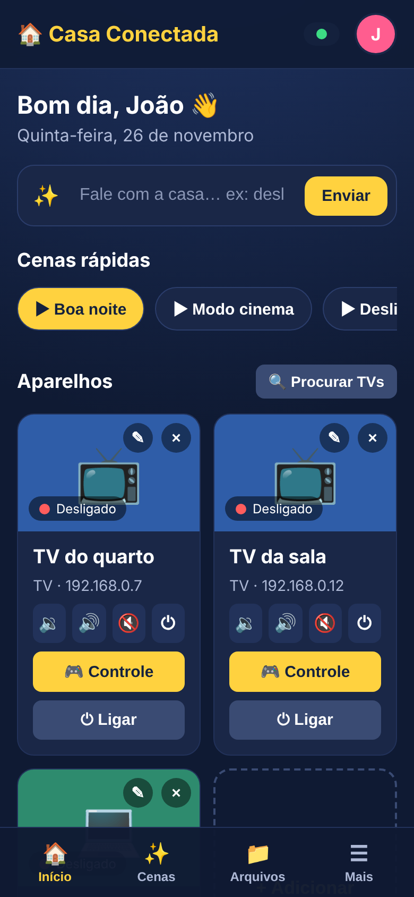
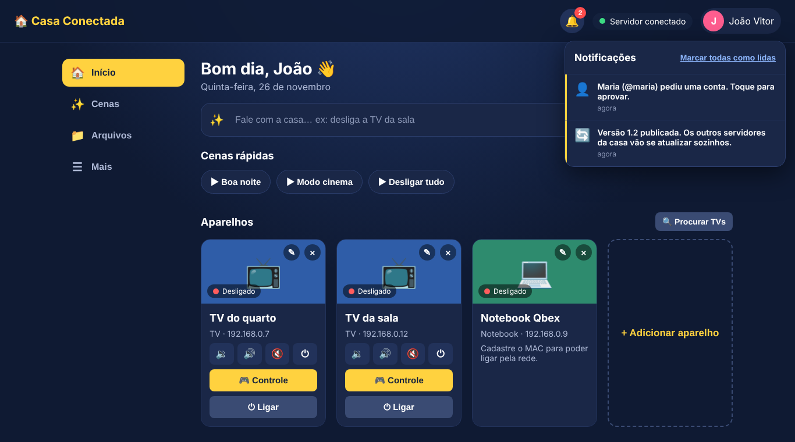
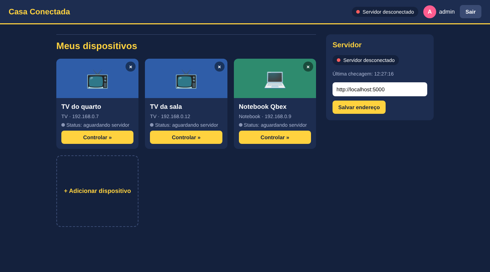

<p align="center"></p>

<h1 align="center">🏠 Casa Conectada</h1>

<p align="center">Um site que roda no computador de casa e controla as TVs e aparelhos pela rede, de qualquer celular ou notebook do Wi-Fi.</p>

<p align="center"><a href="https://joaovitor6002.github.io/casa-conectada/">🌐 Página do projeto</a></p>

---



## O que ele faz

**Controle dos aparelhos**
- Controle remoto completo das TVs Android pela rede (ADB, porta 5555): setas, volume, mídia, canais, teclado numérico, abrir apps, digitar e mostrar mensagens na tela.
- Volume, mudo e desligar direto no card de cada aparelho, na tela inicial.
- Ligar a TV desligada pela rede (Wake-on-LAN + comando de acordar).
- **Procurar TVs na rede**: acha as TVs, diz qual é qual pelo número de série, corrige sozinho o IP de quem mudou e tem o botão "👀 Qual é?", que faz a TV se mostrar.

**Automação**
- **Cenas**: vários passos num clique ("Boa noite", "Modo cinema").
- **Horários**: cenas que rodam sozinhas em dias e horas marcados.
- **Histórico** de tudo o que foi feito, por quem.

**Contas**
- Administrador e usuário comum.
- Foto de perfil, nome de exibição e usuário de login separados.
- "Criar conta" na tela de login, que fica esperando o administrador aprovar.
- "Esqueci minha senha" com código de 6 números enviado por e-mail (Gmail com senha de app).

**Vários servidores, uma casa só**
- O mesmo site roda em mais de um computador (ex.: um notebook novo e um antigo com Windows 7).
- **Atualização automática**: o PC principal publica versões novas e os outros baixam, conferem a assinatura e se atualizam sozinhos.
- **Sincronização** de usuários, aparelhos, cenas, horários e notificações entre os servidores, cifrada com uma chave que só os servidores da casa têm. Se o principal cair, o outro assume os horários.

**Outros**
- 🔔 Notificações: conta para aprovar, servidor que caiu ou voltou, atualização, tentativas erradas de login.
- 📁 Arquivos compartilhados da casa (enviar, baixar, criar pastas).
- 🤖 Assistente de IA (Claude, da Anthropic) que controla os aparelhos por conversa e voz. Já está pronto no código e só precisa de uma chave da API.
- Funciona como app no celular (dá pra "Adicionar à tela de início").

| Celular | Notificações |
|---|---|
|  |  |

## Antes e depois

O projeto começou em **14/11/2026** como uma página simples com a lista de aparelhos, guardada no próprio navegador. Doze dias depois:

| | 14/11/2026 | 26/11/2026 |
|---|---|---|
| Servidor (`servidor.py`) | 3,4 KB | 125 KB · 3.203 linhas |
| Site (`index.html`) | 14,5 KB | 109 KB · 2.276 linhas |
| Endereços da API | 2 | 65 |

| Antes | Depois |
|---|---|
|  |  |

A primeira versão está guardada na pasta [`historia/`](historia/).

## Como funciona

```
Celulares e notebooks (navegador)
          │  Wi-Fi de casa
          ▼
PC principal ── servidor.py (Flask) ──► TVs Android (ADB pela rede, porta 5555)
          ▲  sincronização cifrada + atualizações assinadas
          ▼
Notebook antigo (Windows 7) ── mesmo servidor, recebe as versões novas sozinho
```

- **Servidor:** Python + Flask, num arquivo só (`servidor/servidor.py`).
- **Site:** HTML, CSS e JavaScript puros, sem framework (`site-online/index.html`).
- **Dados:** arquivos JSON numa pasta fora do projeto (`C:\Users\<você>\CasaConectada`), então senhas e chaves nunca entram no Git.
- **Segurança:** o servidor só aceita a rede de casa; senhas guardadas com hash; login por token assinado; bloqueio depois de 5 tentativas erradas; pacotes de atualização e sincronização assinados (HMAC-SHA256) com a chave de cada casa.

## Como rodar

1. Instale o [Python 3](https://www.python.org/) e o Flask: `pip install -r requirements.txt`
2. Baixe o [ADB (platform-tools)](https://developer.android.com/tools/releases/platform-tools) e diga onde ele está:
   `set ADB_PATH=C:\caminho\platform-tools\adb.exe`
3. Ligue o servidor: `python servidor/servidor.py`. Na primeira vez, ele pede para criar o login de administrador.
4. Abra `http://localhost:5000` no PC, ou o endereço que aparece no terminal nos celulares do mesmo Wi-Fi.
5. Na TV: ative as Opções do desenvolvedor, ligue a **depuração (ADB)** e aceite a permissão na primeira conexão.

**Windows 7:** `python win7/montar_pacote.py` gera um `.zip` com Python 3.8 portátil, Flask e ADB. No notebook, é só extrair e rodar o `INSTALAR.bat`.

**IA (opcional):** crie uma chave em [console.anthropic.com](https://console.anthropic.com) (é paga à parte) e cole no arquivo `chave_anthropic.txt` da pasta de dados.

## Próximos passos

- [ ] Ícone próprio do Casa Conectada
- [ ] "Esqueci a senha" aceitando usuário ou e-mail
- [ ] Enviar arquivos do celular para os notebooks pelo site (tipo LocalSend)
- [ ] Controles próprios para cada tipo de aparelho: TV, celular, notebook e servidor
- [ ] Aba "Servidores" com o estado de cada computador da casa
- [ ] Nuvem da casa: fotos, filmes (Jellyfin) e bloqueador de anúncios
- [ ] Ativar o assistente de IA

---

Feito por **João Vitor** ([@joaovitor6002](https://github.com/joaovitor6002)), com a ajuda do Claude (Anthropic) na programação.
